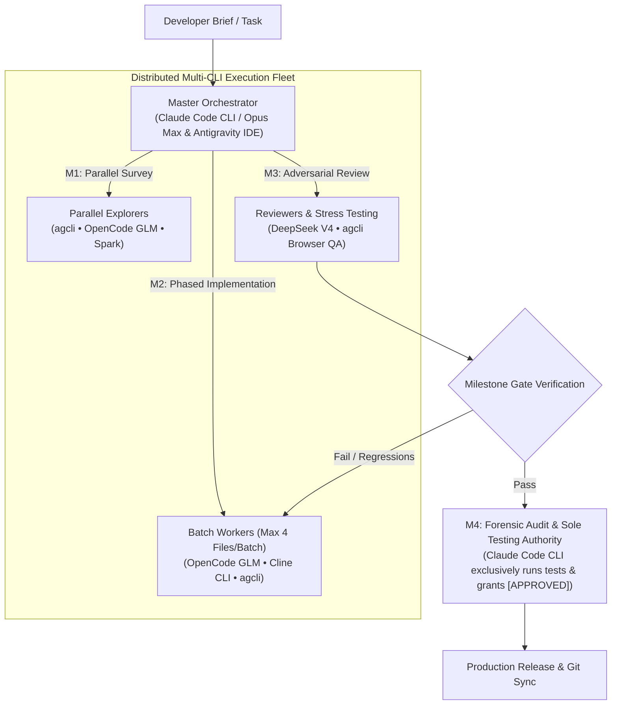

<p align="center">
  <h1 align="center">⚡ AgentFleet</h1>
  <p align="center"><strong>The Open Source Multi-CLI Agent Fleet Orchestrator & Context Governance Framework</strong></p>
</p>

<p align="center">
  <a href="https://github.com/ibrahimalkateb965-tech/Claude-Antigravity-Workspace/blob/main/LICENSE"></a>
  <a href="https://www.python.org/downloads/"></a>
  <a href="#"></a>
  <a href="#"></a>
  <a href="#"></a>
  <a href="#"></a>
</p>

<p align="center">
  <strong>[English] | <a href="README.ar.md">🌐 اقرأ باللغة العربية (README.ar.md)</a></strong>
</p>

---

## 📖 Overview

**AgentFleet** (developed inside the *Claude & Antigravity Ecosystem*) is a production-grade, open-source orchestration framework that federates frontier AI coding CLI harnesses (**Claude Code CLI**, **Antigravity CLI / Gemini**, **OpenCode CLI**, and **Codex CLI**) into a cooperative, autonomous engineering team.

Rather than relying on a single agent that hallucinates, suffers context rot, or explodes token costs, AgentFleet implements **Separation of Concerns**, **Progressive Disclosure**, and **Adversarial Quality Gates** to deliver production-grade software with zero token waste.



---

## 🚀 Key Architectural Pillars

### 1. Collaborative Multi-CLI Division of Labor
Different models possess distinct superpowers and cost structures. AgentFleet orchestrates them cooperatively:
* **Claude Code CLI (`Opus 5.5 Max / Sonnet 5.5`)**: High-level architectural planning, Devil's Advocate audits, and **Exclusive Testing Monopoly** (`[C-21]`). Only Claude Code is authorized to run automated tests and grant final sign-off.
* **Antigravity CLI (`agcli` - Gemini 3.8 Flash High)**: Headless terminal executor for responsive UI architectures, Jetpack Compose, Web views, and DOM manipulation.
* **OpenCode CLI (`GLM 5.3 Flash` & `Meta Muse Spark 1.3`)**: Fast, high-throughput terminal executor for shell commands, database migrations, DAOs, repositories, and backend endpoints (`[C-31]`).
* **Codex CLI (`GPT-6.1 Soul`)**: Complex mathematical parsers, deep algorithmic refactoring, and data transforms.
* **Antigravity IDE**: Visual interactive developer workbench and cockpit for real-time human-in-the-loop inspection.

### 2. Context Window Governance (The 30k – 300k Sweet Spot)
Standard coding assistants degrade rapidly as conversational context expands. AgentFleet actively enforces a **Golden Productivity Zone**:
* 🟢 **Green Zone (< 180k tokens)**: 100% attention fidelity. Standard progressive disclosure (`mode=signatures`).
* 🟡 **Yellow Zone (180k – 240k tokens)**: Full file reads banned; slice inspections restricted to $\le 50$ lines.
* 🟠 **Orange Zone (240k – 300k tokens)**: Finalize micro-task, commit clean Git state, snapshot lessons.
* 🔴 **Red Zone (> 300k tokens)**: Attention degradation barrier. Enforces Hook 25 (`/strategic-clear`) and generates structured resumption prompts.

### 3. Continuous Automation via 32 System Hooks
AgentFleet contains 32 automated triggers that fire deterministically:
* **Hook 01**: Session Start & RTL / Linguistic Guard.
* **Hook 03**: Smart Agent Tailoring & Dynamic Pruning (`project_agent_tailor.py`).
* **Hook 19**: Post-Edit Quality & Clean Code Guard.
* **Hook 22**: Multi-CLI Fleet Session Mode & Autonomous Delegation.
* **Hook 26**: Prompt Library Curator & Excel Automation.
* **Hook 27**: SQLite WAL Context Window Telemetry Advisor.
* **Hook 31**: Multi-CLI Fleet Teamwork Orchestrator (`fleet_teamwork_orchestrator.py`).
* **Hook 32**: Loka Context Orchestrator & Minimal Blast Radius Build OS.

### 4. Zero-Cost Hybrid Web QA Testing (`[C-96]`)
To eliminate token burn on routine browser validation, **`Antigravity CLI (agcli)`** coupled with **`webapp-qa-tester`** (Playwright + Chrome DevTools MCP) runs granular UI assertions, button clicks, and screenshot diffs locally ($0.00 cost). It compiles a 100% green execution matrix submitted to Claude Code for final sign-off.

---

## ⚡ 60-Second Quickstart

### Prerequisites
* Python 3.10 or higher.
* Git.

### 1. Installation
Clone the repository and install `agentfleet` in editable mode:
```bash
git clone https://github.com/ibrahimalkateb965-tech/Claude-Antigravity-Workspace.git
cd Claude-Antigravity-Workspace
pip install -e .
```

### 2. Verify Installation
```bash
agentfleet status
```

### 3. Initialize a Teamwork Task (Hook 31)
```bash
# Initialize a distributed fleet milestone preview
agentfleet teamwork init --name "Feature_X" --objective "Implement offline sync caching"

# Inspect active milestone gates
agentfleet teamwork status
```

### 4. Launch Interactive Web Explorers
AgentFleet bundles built-in interactive HTML5 web applications:
```bash
# Launch Dynamic Hooks Library visualizer
agentfleet hooks --open

# Open prompt library curator
agentfleet curate --help
```

---

## 📁 Repository Structure

```
Claude-Antigravity-Workspace/
├── pyproject.toml              # Modern Python packaging configuration
├── LICENSE                     # Official MIT License
├── README.md                   # Primary English documentation
├── README.ar.md                # Comprehensive Arabic guide & architecture
├── fleet_config.json           # Multi-model tiering matrix & configuration
├── HOOKS_GUIDE.md              # Canonical specification for all 32 hooks
├── ACTIVE_CONTEXT_INJECTION.md # Mandatory technical invariants & constraints
├── tools/                      # Core automation and orchestration tools
│   ├── cli.py                  # Unified 'agentfleet' CLI entrypoint
│   ├── fleet_teamwork_orchestrator.py # Hook 31 multi-CLI teamwork engine
│   ├── prompt_library_curator.py      # Hook 26 prompt knowledge base
│   └── ag_context_monitor.py          # Hook 27 context telemetry monitor
├── .agents/                    # Specialized agent cards, skills, and templates
│   ├── skills/                 # 90+ modular skills (MCP, A11y, Compose, Web)
│   └── fleet_teamwork/         # Ephemeral metadata ledgers for active milestones
├── 03_Dynamic_Hooks_Library/   # Interactive browser-based hooks explorer
├── 03_Dynamic_Prompt_Library/  # Interactive prompt management application
└── .github/workflows/          # GitHub Actions CI/CD pipelines
```

---

## 🤝 Contributing

We welcome contributions from the global open-source community!
Please review [CONTRIBUTING.md](CONTRIBUTING.md) for guidelines on submitting new agent skills, CLI adapters, or hook specifications.

---

## 🛡️ Security

For reporting security vulnerabilities or privacy inquiries, please refer to our [SECURITY.md](SECURITY.md).

---

## 📄 License

This project is open-source software licensed under the [MIT License](LICENSE).
Copyright (c) 2026 Ibrahim Ahmed Ibrahim Alkateb.
